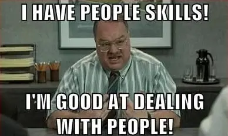

RSE is About People
********************************************************************************

The recent discussions about LLM usage in Research Software Engineering (RSE) emphasizes one important thing to me - RSE is about people.
(Really, software engineering is about people.)

As a case in point, the discussions around controlling quality of software in an era with LLM usage often seem to come around to using Software Development Lifecycle (SDLC) concepts.
The study of how software is made came out of efforts to understand and improve how humans make software in teams.
Many of the phases of SDLC, such as conceptualization, requirements analysis, acceptance, deployment, and maintenance, are focused around human communication and interaction.

When we template these SDLC activities back onto RSE activities the human element remains important regardless of wether a portion of the work is done with an LLM.
The software we develop should match requirements for some human researcher's needs.
The decision to accept the software is judged against those needs, and maintenance or extension activities are to continue supporting these needs.
We like to focus on the technical or scientific details, but ultimately the human element is what determines if our work is impactful.

We sometimes use loaded language such as 'soft' skills to describe our ability to carry out these human focused components in our jobs in contrast to the 'hard' skills of technical implementation.
However, these interpersonal skills really need to be at the forefront of our efforts, as it is the human impact that matters because our job as RSEs is to support science and education.
The software development is the tool we use to meet these human concerns as opposed to an end onto itself.

Metadata
================================================================================

Started: 08 Oct 2026

Last edited: 13 Oct 2026
